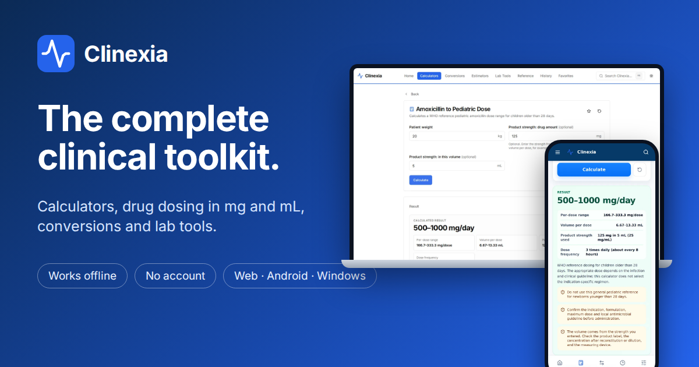

# Clinexia v2.0

Clinexia is a complete clinical toolkit and progressive web app: medical calculators, drug dosing (mg per dose and mL per dose), unit conversions, laboratory tools and reference ranges. This version (v2.0) features a modern frontend built with Next.js, TypeScript, and Tailwind CSS, designed for a smooth, responsive user experience.

---

## Live Demo

[Clinexia v2.0 Live](https://www.clinexia.app/)


---

## Tech Stack

- **Next.js** (App Router) - for page routing, server rendering where needed, and fast frontend performance  
- **TypeScript** - static typing for safer, more maintainable code  
- **Tailwind CSS** - utility-first CSS for rapid UI development and consistent design  
- **React hooks / client-side state** - for form handling, conversion logic, and interactive components  
- **GitHub + Vercel** - version control and deployment  

---

## Features

- Clinical calculators, drug dosing with mg and mL per dose, and unit conversion for clinical and laboratory metrics  
- Responsive layout, mobile & desktop friendly  
- Real-time input validation and conversion feedback  
- Modular component architecture (conversion cards, input fields, selection controls)  
- Clean, user-friendly UI  

---

## Project Structure

```

/app                   ─ Next.js pages/components (routes, layout, etc.)
/components            ─ Reusable React components (cards, inputs, buttons, etc.)
/hooks                 ─ Custom React hooks for state & logic
/lib                   ─ Utility functions (conversion algorithms, helpers)
/public                ─ Static assets (images, icons, etc.)
/styles                ─ Global and Tailwind config/style overrides
next.config.mjs        ─ Next.js configuration
tailwind.config.ts     ─ Tailwind configuration
tsconfig.json          ─ TypeScript configuration

````

---

## Installation & Setup

```bash
git clone https://github.com/dBillionaire-Dev/Clinexia_v2.0.git
cd Clinexia_v2.0
# Use npm or your preferred package manager
npm install
# or
yarn install
# or
pnpm install

# Run in development mode
npm run dev
# or
yarn dev
# or
pnpm dev
````

Visit `http://localhost:3000` (or whatever port your setup uses) to view.

---

## How to Use

1. From the home page, select the conversion or calculator tool you want (e.g. BMI, temperature, chemical units, etc.).
2. Input the value(s) to convert.
3. View the result immediately after input, with real-time feedback or validation.

---

## Future Improvements (Ideas)

* Add theme toggle (dark/light mode)
* Add more unit types (e.g. more chemical units, more complex lab metrics)
* Improve accessibility (keyboard navigation, screen reader support)
* Add localization/multi-language support
* Unit tests / integration tests for conversion logic

---

## Author

**dBillionaire-Dev**

---

## Contact

For issues or feature requests, open a GitHub issue in this repo or contact me via email / social profile

## Anonymous Usage Analytics

Clinexia can record successful calculator usage without requiring users to register. Each browser gets an anonymous installation ID, and calculation events are first placed in an IndexedDB outbox so usage is retained while offline. When connectivity returns, pending events are uploaded to the Next.js analytics API and stored in Supabase.

### Setup

1. Create a Supabase project.
2. Run `supabase/analytics.sql` in the Supabase SQL Editor.
3. Add the variables from `.env.example` to your local environment and Vercel:
   - `SUPABASE_URL`
   - `SUPABASE_SERVICE_ROLE_KEY` (server-only)
   - `ADMIN_PASSWORD`
   - `ADMIN_SESSION_SECRET` (at least 32 characters)
4. Open `/admin` and sign in with `ADMIN_PASSWORD`.

The implementation records tool metadata and timestamps, not calculator input values or patient identifiers.

Offline events remain in the browser's IndexedDB until the server confirms receipt. The analytics API is intentionally outside the calculator's critical path, so a failed network request never prevents a calculation from working.

### Analytics console

`/admin` provides total calculations, today's usage, seven-day usage, offline-synced calculations, top calculators, category usage, and a 14-day usage chart.

### Existing history backfill

When analytics is first enabled, Clinexia performs a one-time migration of calculation history that is still present in the user's local IndexedDB. Historical entries are queued using their existing history IDs, so an interrupted migration can safely retry without double-counting. Only calculator metadata and timestamps are sent; existing calculation inputs and results remain local. Historical entries are labelled separately in the admin console as **Historical backlog**.

## Anonymous Usage Analytics

Clinexia can record calculator usage without requiring users to register. Events are queued locally in IndexedDB first, so calculations made offline can sync later when connectivity returns. The `/admin` management console shows aggregate usage across the deployed application.

Analytics can distinguish:
- `web` - normal browser usage
- `pwa` - installed/standalone PWA usage
- deployment `environment` - configured with `NEXT_PUBLIC_APP_ENV`
- `appVersion` - application version recorded by the tracker
- historical backlog - calculations imported once from an existing user's local History

The analytics implementation does not send calculator inputs or results. Run `supabase/analytics.sql` in Supabase before enabling the server-side analytics API.

<!-- clinexia-distribution -->
## Landing page, domains and app stores

### Landing page and two domains

The landing page lives at `/welcome`. With two domains configured, the **landing domain** shows it at `/` and redirects every app page to the **app domain** (`proxy.ts`). Nothing happens until the variables below are set, and hosts that are not listed (localhost, preview deployments, the old address) behave as before.

| Variable | Example | Purpose |
|---|---|---|
| `NEXT_PUBLIC_LANDING_URL` | `https://example.com` | the marketing landing page |
| `NEXT_PUBLIC_APP_URL` | `https://app.example.com` | the web app / PWA |
| `NEXT_PUBLIC_SITE_URL` | `https://app.example.com` | metadata, robots and sitemap of the app |
| `NEXT_PUBLIC_LEGACY_HOSTS` + `NEXT_PUBLIC_LEGACY_REDIRECT=on` | `old-address.vercel.app` | optional: retire an old address by redirecting it to the app domain |

Variables starting with `NEXT_PUBLIC_` are baked in at build time: redeploy after changing them.

### Download buttons on the landing page

A channel with no URL shows "coming soon". Nothing is invented.

| Variable | What it enables |
|---|---|
| `NEXT_PUBLIC_PLAY_STORE_URL` | Google Play button |
| `NEXT_PUBLIC_FIREBASE_DIST_URL` | Firebase App Distribution beta invite link |
| `NEXT_PUBLIC_APK_URL`, `NEXT_PUBLIC_APK_SHA256`, `NEXT_PUBLIC_APK_VERSION` | direct APK download, with its checksum shown |
| `NEXT_PUBLIC_MS_STORE_URL` | Microsoft Store button |
| `NEXT_PUBLIC_IARC_RATING_ID` | age-rating id written into the web manifest (Microsoft Store) |

The Android build, signing, Firebase and Google Play steps are in the mobile repository (`docs/RELEASE.md`).

### Windows: Microsoft Store with PWABuilder

The web manifest (`app/manifest.ts`) is written to pass [PWABuilder](https://www.pwabuilder.com): a stable `id` and `scope`, `standalone` display, 192 and 512 px icons (including maskable), wide and narrow screenshots, shortcuts, categories, Edge side-panel and launch-handler hints, and optional `iarc_rating_id` and related-application entries.

1. Deploy the app on HTTPS at the app domain.
2. Open pwabuilder.com, enter the app URL and press **Start**. The Manifest, Service Worker and Security sections should pass. Fix anything it lists.
3. **Package for stores → Windows.** Fill in the package id, publisher id and publisher display name from Microsoft Partner Center (Product identity), then generate the package.
4. In Partner Center: reserve the name, upload the package, complete the age-rating questionnaire (copy the IARC id into `NEXT_PUBLIC_IARC_RATING_ID` and redeploy), add screenshots (`/screenshots/wide-*.png`) and a privacy policy URL (state the anonymous usage statistics honestly).
5. When it is published, set `NEXT_PUBLIC_MS_STORE_URL` and redeploy.

### Drug doses: mg per dose and mL per dose

Single-drug dosing calculators show the dose in mg for one administration. Enter the product strength from its label (for example 125 mg in 5 mL) and they also show the volume per dose in mL. With no strength entered, no volume is shown, and nothing is assumed. Tablet-band regimens, fixed-dose combinations, fluids, infusion rates and multi-drug protocols are deliberately excluded. The logic is in `lib/calculators/dose-volume.ts`.

<!-- clinexia-traction -->
## Traction metrics (admin)

Verifiable, privacy-first usage metrics for due diligence. Read-only dashboard at **`/admin/traction`** (same password login as `/admin`), a printable **Buyer report** at `/admin/traction/report`, and manual **Revenue** entry at `/admin/traction/revenue`.

### What is stored (and what is not)
Only: event type, tool id/name, platform (`web | pwa | android | windows`), app version, an anonymous random visitor id and a timestamp. Never patient data, calculator inputs or results, IP addresses or anything personally identifying. Search Console and GitHub data are aggregate counts from those services.

**Privacy page.** Before shipping, add one sentence to `app/privacy/page.tsx` where anonymous statistics are described, for example: *"We also record, per day, whether an installation was active (and roughly how many sessions), and when the app was installed, using the same anonymous random ID. We do not use this to identify anyone."* The tool-usage events and anonymous ID are already described there.

### Setup
1. **Database:** run `supabase/traction.sql` once in the Supabase SQL editor (safe to re-run). It creates the new tables, the activity view and two helper functions, with row-level security on and no public access.
2. **Env vars** (server only; the first two already exist for analytics):

| Variable | Purpose |
|---|---|
| `SUPABASE_URL`, `SUPABASE_SERVICE_ROLE_KEY` | database access |
| `ADMIN_PASSWORD`, `ADMIN_SESSION_SECRET` | admin login (existing) |
| `APK_REPO` | `owner/repo` of the mobile repo, default `dBillionaire-Dev/Clinexia_V3.0-Mobile` |
| `APK_GITHUB_TOKEN` | optional; only needed if that repo is private (read-only access to releases) |
| `GSC_SITE_URL` | Search Console property: `sc-domain:example.com` (Domain property) or `https://example.com/` (URL-prefix; the trailing slash matters) |
| `GSC_SERVICE_ACCOUNT_JSON` | the service-account key file contents (or `GSC_CLIENT_EMAIL` + `GSC_PRIVATE_KEY`) |

3. **Daily job:** `.github/workflows/traction-daily.yml` runs every day at 03:20 UTC (GitHub Actions, free). Add the variables above as repository **secrets** (and `APK_GITHUB_REPO` as a repository *variable* if you need to override the repo). It takes the GitHub snapshot, syncs Search Console, then rebuilds rollups. Run it by hand from the Actions tab; tick *backfill* to pull Search Console history.

### Giving the API access to Search Console
1. Google Cloud Console → create/select a project → **APIs & Services → Library** → enable **Google Search Console API**.
2. **IAM & Admin → Service Accounts → Create**, then **Keys → Add key → JSON** and download the file. Note the service account's email (`…@….iam.gserviceaccount.com`).
3. [Search Console](https://search.google.com/search-console) → pick your property → **Settings → Users and permissions → Add user** → paste the service-account email → permission **Restricted** (read-only) is enough.
4. Put the whole JSON file's contents in `GSC_SERVICE_ACCOUNT_JSON` and set `GSC_SITE_URL` to the property exactly as listed in Search Console.

### Backfill and manual runs
Locally, with the vars in `.env.local` (Node 22+):

```bash
pnpm traction:rebuild          # rebuild daily_rollups / tool_usage_daily / pwa_installs_daily from EVERY stored event (idempotent)
pnpm traction:github           # store today's APK download snapshot (+ baseline for first-seen releases)
pnpm traction:gsc-backfill     # ~16 months of Search Console history (the API maximum)
pnpm traction:gsc              # last 10 days (recent days get revised, so they are overwritten)
```
All jobs upsert by primary key, so they are safe to re-run. Order for a first run: `traction:rebuild`, `traction:github`, `traction:gsc-backfill`.

### How the numbers are defined
- **Active user:** a distinct anonymous id with ≥1 production calculation *or* ≥1 heartbeat that day. Before heartbeats were stored, only users who ran a calculation can be counted, and devices that never returned after analytics shipped are invisible. The Data coverage panel states this.
- **New / returning:** first-ever active day in stored data / active on a later day. **Returning %** = share of users active in the last 30 days who were seen on 2+ different days. **D1/D7/D30** = share of a first-day cohort active exactly N days later (only cohorts old enough are counted).
- **Sessions:** a heartbeat that is the first of the day or >30 min after the previous one. Recorded only from the day this feature is deployed; earlier days show “–”, not zero.
- **APK downloads:** GitHub exposes cumulative counts only. The first time a release asset is seen, its current total is stored as a *baseline* dated to the release's published date (the exact day-by-day split is unknown); later daily snapshots give real daily deltas. Only GitHub downloads are counted. A decreasing counter (asset deleted and re-uploaded) is treated as a reset.
- **PWA installs:** the browser `appinstalled` event, one per anonymous id. Safari/iOS never fires it, so this undercounts.
- **Windows:** standalone display mode on a Windows user agent. An installed Chrome/Edge PWA and the Microsoft Store package cannot be told apart, so treat it as best-effort.
- Days use the **Africa/Lagos** calendar. Search Console reports in Pacific time and lags about 2 days.

### Verifying the numbers against the raw sources
- **Usage:** in Supabase, `select count(*) from calculation_events where environment='production';` should equal the sum of `daily_rollups.tool_uses` where `platform='all'`. `select count(distinct anonymous_id) from traction_activity_days where day between current_date - 29 and current_date;` matches the MAU card (use the Lagos date).
- **APK:** compare the latest `apk_downloads_snapshots.download_count` per asset with `https://api.github.com/repos/<owner>/<repo>/releases` (`download_count` on each asset).
- **Search Console:** export the same date range from the Search Console UI (Performance → Export) and compare clicks/impressions; query-level totals are lower because Google omits anonymized queries.
- **Installs:** `select count(*) from pwa_install_events;`.
- Every dashboard table has an **Export CSV** link for independent checking.

### Tests
`pnpm test` includes `lib/traction/*.test.ts`: rollup, retention, window, GitHub snapshot/delta, Search Console mapping/JWT and CSV tests.

### Security notes
The login now uses a constant-time password check and a best-effort in-memory throttle (serverless instances do not share memory, so use a long `ADMIN_PASSWORD`). The users table in `/admin` can rename pseudonymous users; avoid entering real names there, and do not show that table to buyers.

<!-- clinexia-diagnostics -->
## Keeping open windows current, and the diagnostics page

### The problem this solves
The app is an installed, offline-first web app. After a deploy, a window that stays open (an office PC, an installed PWA) keeps running the old version, because the service worker serves cached pages first and nothing told the open page that a newer one exists.

### How it updates now
`components/update-watcher.tsx` (mounted in `app/layout.tsx`) compares this copy's build id with the live one from `GET /api/version`:

| Situation | What happens |
|---|---|
| App just opened (first 20 s) and nothing touched yet | refreshes itself immediately |
| Window in use | a small banner: **A new version of Clinexia is ready. [Refresh now] [Later]** |
| Window hidden or minimised for 2+ minutes | refreshes itself |
| Window untouched for 15+ minutes | refreshes itself |
| Quick alt-tab | never refreshes |
| Offline, or the live version cannot be reached | does nothing |

It checks 2 seconds after opening, every 15 minutes, when the window is brought back to the front, and when the connection returns. Before reloading it replaces the cached copy of the current page with a fresh one (otherwise the service worker would show the old page again), and after the update it re-fetches the offline cache in the background, once per build. It will not reload twice in a row for the same build, so a failure can never become a reload loop. The service worker file itself is unchanged.

**Build id.** `next.config.mjs` sets `NEXT_PUBLIC_BUILD_ID` from `VERCEL_DEPLOYMENT_ID` (or `VERCEL_GIT_COMMIT_SHA`). On Vercel keep *Settings → Environment Variables → Automatically expose System Environment Variables* on. On other hosts set `NEXT_PUBLIC_BUILD_ID` to something that changes on every deploy. If it is empty, automatic updating is simply off (the diagnostics page says so). If you use Vercel *Skew Protection*, check that `/api/version` from an old page returns the newest deployment's id; if it does not, turn skew protection off for this project or the old windows will not notice.

The first deploy that contains this feature cannot reach windows that are already open on an older version; those pick it up the next time they are reloaded or reopened. Every deploy after that reaches them by itself.

### Diagnostics page
`/diagnostics` (on the app address) is hidden: not linked, not in the sitemap, `noindex`. It shows the app version and build, whether a newer version is live, how many usage events are waiting to send (and the oldest), whether the history re-send has run on this device, the service worker and offline cache state, and a masked anonymous id. **Check again**, **Send waiting events now**, **Copy report** and **Update now** are on the page. It reads only this device and shows no calculator inputs, results or history (only a count of history items). A screenshot of it is enough for support.

On Chrome and Edge for Windows an installed app window and a normal tab share the same stored data, so opening `/diagnostics` in a tab on that PC shows the same counts; the *Running as* row will say "browser tab".

### Tests
`lib/update/policy.test.ts` covers the refresh rules, the no-reload-loop guard, the report (including that the full anonymous id is never printed) and keeps the diagnostics page's history re-send flag in step with `lib/analytics/backfill.ts`.

<!-- clinexia-landing-apk -->
## Diagnostics shortcut and the landing-page APK

### Shortcut to the diagnostics page
Press **Win + Shift + D** (Cmd + Shift + D on a Mac) anywhere in the app to open `/diagnostics`. It works in the browser, the installed app and the Windows app, because they all run the same web code (`components/diagnostics-shortcut.tsx`). **Ctrl + Alt + Shift + D** does the same and is there for machines where Windows, a keyboard utility or the desktop environment keeps the Windows key for itself. Plain Win+D, Ctrl+Shift+D and typing a capital D are never captured. Phones have no keyboard, so there is no shortcut there. `/diagnostics` is also in the offline cache, so it opens without a connection.

### The landing page follows the latest Android release
`app/welcome/layout.tsx` reads `version.json` from the mobile repo's `main` branch on the server (`lib/latest-apk.ts`) and links the newest release asset, with its version number. The page refreshes in the background at most every 10 minutes, so a release shows up on the landing page by itself, with nothing to change in Vercel. Only a `.apk` release asset of the repo named in `APK_REPO` (default `dBillionaire-Dev/Clinexia_V3.0-Mobile`) is accepted, and visitors' browsers never contact GitHub.

If GitHub cannot be reached, the page falls back to `NEXT_PUBLIC_APK_URL`. Set that to the stable address `https://github.com/<owner>/<repo>/releases/latest/download/Clinexia.apk` (the mobile release now uploads a version-less `Clinexia.apk` with every release) and it never goes out of date either. `NEXT_PUBLIC_APK_VERSION` is no longer needed; remove it, or the label could briefly show an old number when the fallback is used. If the mobile repo is private, the server cannot read `version.json`, and the fallback link will not work for visitors either.

<!-- clinexia-feedback -->
## User feedback (popup, /feedback page, admin)

### What users see
- After someone has really used Clinexia (3 or more calculations, or 3 or more different days), a small popup asks **How is Clinexia working for you?** with five stars. It never appears in the first minute, offline, on the landing site, on `/admin`, `/feedback` or `/diagnostics`.
- Tapping a star opens **`/feedback`** with that rating filled in: four short steps (about a minute). About you (healthcare or not, which area), how you use it (devices, personal or work, kind of workplace), premium (would you pay, a reasonable monthly price in naira, who pays, an optional monthly price for a 10-seat team) and up to three optional open questions (improve, what is missing, anything else).
- **Later** hides it and brings it back after the configured number of hours, at most the configured number of times, then it stops. Sending feedback ends it for good, exactly like the install prompt. A draft is saved on the device, so nothing is lost if someone leaves halfway.
- Someone who rated 4 or 5 stars gets a **Share Clinexia** button on the thank-you screen.

### Admin: `/admin/feedback`
Turn the popup on or off, set how many hours "Later" waits and the maximum number of "Later" taps, and **Ask everyone again** (starts a new round, so people who already answered, or said never, are asked once more; earlier answers are kept and can be viewed by round). It shows the averages, who is answering, premium interest and price bands, every written answer, a **Delete** button for each response (use it if someone typed personal details) and a CSV export. `/admin/traction` also has a **Road to 1,000 users** bar.

### Setup
1. Run `supabase/feedback.sql` in the Supabase SQL editor. It is safe to re-run, and it upgrades a table made by an earlier version (days are converted to hours). The popup is **on** from the moment it runs; to prepare first, pause it in `/admin/feedback`.
2. Deploy. Nothing else to configure (it uses the same Supabase variables as the traction metrics).

### Privacy
Answers are anonymous: no name, email, phone or IP address. The only identifier is the random anonymous id the usage statistics already use, kept so one device cannot send twice in a round; it is never shown or exported. The form warns people not to type patient or personal details. **Add one line to the privacy page**, for example: *"If you choose to send feedback, your answers are stored with your anonymous ID. We never ask for your name, email or any patient information."*

### How the numbers are read
Prices are in Nigerian naira. Typical prices are estimates from the midpoints of the price bands people picked, only among those who answered "yes" or "maybe", and the page says so. Device counts add up to more than 100% because people can pick several.

### Tests
`lib/feedback/feedback.test.ts` covers the answer rules, when the popup shows, Later, done, never and new rounds, the submission and rate-limit checks and the admin summary.
